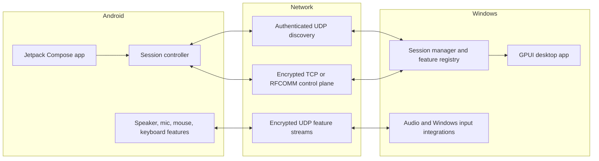

# WireWave

WireWave connects an Android phone to a Windows PC over Wi-Fi or Bluetooth. It provides encrypted speaker streaming, microphone streaming, mouse control, and keyboard input through native desktop and Android applications.

Current release version: **1.2.5**

## Features

- Stream Windows audio to an Android phone.
- Use an Android microphone as an input source on Windows.
- Control the Windows pointer from the Android touch surface.
- Send text and key commands from Android to Windows.
- Discover desktops through authenticated UDP announcements on local networks.
- Connect through Wi-Fi TCP or Bluetooth Classic RFCOMM.
- Pair new devices with a time-limited six-digit code.
- Reconnect trusted devices with cryptographic challenge-response authentication.
- Keep an Android connection active through a foreground service when enabled.
- Check, download, verify, and install application updates.

Camera streaming and virtual-camera components are not included in this version.

## Platform requirements

| Component | Requirement |
| --- | --- |
| Desktop | Windows 11, build 22000 or newer |
| Android | Android 11 / API 30 or newer |
| Wi-Fi mode | Phone and PC reachable on the same LAN or phone hotspot |
| Bluetooth mode | Bluetooth Classic support and an existing OS-level pairing |
| Desktop build | Stable Rust toolchain; NSIS for installer packaging |
| Android build | JDK 17 and Android SDK 34 |

Microphone streaming requires a compatible Windows playback/input path selected in WireWave settings. Android asks for microphone permission only when the microphone feature is activated.

## Quick start

### Install a release

1. Download `WireWave-Setup-<version>.exe` and `WireWave-Android-<version>.apk` from the matching GitHub release.
2. Install the desktop application on Windows and the APK on Android.
3. Open WireWave on both devices.
4. Select the PC on Android.
5. For the first connection, enter the six-digit code displayed by the desktop.
6. Enable speaker, microphone, mouse, or keyboard controls from the connected screen.

### Run from source

```powershell
git clone https://github.com/shah-ashish/wirewave_app.git
cd wirewave_app
cargo run -p wirewave-desktop
```

In a second terminal, build the Android debug APK:

```powershell
cd apps/android
.\gradlew.bat :app:assembleDebug
```

The APK is written under `apps/android/app/build/outputs/apk/debug/`.

## Common commands

| Command | Purpose |
| --- | --- |
| `cargo run -p wirewave-desktop` | Run the desktop application |
| `cargo check --workspace --all-targets` | Type-check the Rust workspace |
| `cargo test --workspace --lib` | Run Rust library tests |
| `cargo build --release -p wirewave-desktop` | Build the optimized Windows executable |
| `cd apps/android; .\gradlew.bat test` | Run Android unit tests |
| `cd apps/android; .\gradlew.bat :app:assembleDebug` | Build the debug APK |
| `cd apps/android; .\gradlew.bat :app:assembleRelease` | Build the release APK; signing variables are required |

## Architecture

WireWave is a vertical-slice monorepo. Infrastructure and protocol contracts live in `core/`, user-facing capabilities live in `features/`, and `apps/` contains thin composition shells for dependency wiring, navigation, window chrome, and Android lifecycle services.



### Dependency rules

- `core/<module>/{rust,android}` contains shared infrastructure and contracts. Core modules never depend on features or applications.
- `features/<slice>/{rust,android}` contains a complete capability and may depend only on core modules.
- Features do not import other features.
- `apps/desktop` and `apps/android` compose the modules and own platform lifecycle wiring.
- `config/theme.json`, `config/wirewave.config.json`, and `version.json` are the single sources of truth for theme, product configuration, and release versioning.

### Core modules

| Module | Responsibility |
| --- | --- |
| `core/config` | Loads app configuration, theme tokens, build channel, ports, platform minimums, and asset paths |
| `core/identity` | Creates and persists the stable local device identifier |
| `core/compatibility` | Checks Windows and Android platform requirements |
| `core/updater` | Reads update manifests, downloads artifacts, verifies SHA-256, and launches installation or store pages |
| `core/crypto` | Ed25519 identity keys, X25519 key exchange, session-key derivation, OTP proofs, signatures, and authenticated encryption |
| `core/transport` | Transport kinds, control messages, rejection codes, and length-prefixed `WW2F` frames |
| `core/discovery` | Signed Wi-Fi discovery announcements and Android host scanning |
| `core/session` | Pairing, trusted reconnect, heartbeats, trust storage, preferences, transport selection, and feature lifecycle |
| `core/stream` | Encrypted UDP channels, stream identifiers, sequence numbers, replay protection, and MTU enforcement |

### Feature modules

| Feature | Desktop responsibility | Android responsibility | Direction |
| --- | --- | --- | --- |
| `speaker` | Capture and encode Windows output audio | Buffer, decode, and play through `AudioTrack` | PC to phone |
| `mic` | Decode and render incoming microphone audio | Capture, resample, encode, and send microphone audio | Phone to PC |
| `mouse` | Decode events and inject Windows pointer input | Produce movement, click, button, and scroll events | Phone to PC |
| `connection` | Display idle, pairing, connected, and service state | Discovery, pairing, connected navigation, mouse screen, and overlays | Both |
| `settings` | Connection, trusted devices, services, drivers, compatibility, about, and update UI | Connection, mouse, trusted-device, about, compatibility, and update UI | Local configuration |

### Application shells

- `apps/desktop` initializes tracing, configuration, identity keys, the Tokio runtime, session manager, feature hosts, and the GPUI window. Its NSIS script packages the release executable.
- `apps/android/app` creates the dependency container, Compose navigation, foreground connection service, permission flow, and feature-engine lifecycle.

## Runtime flows

### Discovery and connection

1. Android sends a `WW2D` probe to UDP port `3032` on active IPv4 interfaces.
2. Desktop replies with an Ed25519-signed announcement containing its identity, name, TCP port, and busy state.
3. Android verifies the signature before showing the host.
4. Android connects to TCP port `3030`, or uses the configured Bluetooth RFCOMM service UUID.
5. Both sides exchange `WW2F` length-prefixed control frames. Frames larger than 64 KiB are rejected.

### First-time pairing

1. Both peers provide persistent Ed25519 public keys and ephemeral X25519 public keys.
2. Desktop displays a six-digit OTP valid for 60 seconds.
3. Android submits an OTP proof and signs the exchange transcript.
4. Desktop verifies the proof and signature, then signs the transcript for Android to verify.
5. Both sides derive the same session key and persist the trusted peer identity.

The configured pairing limit is three OTP attempts.

### Trusted reconnect

Trusted peers skip the OTP. Desktop sends a fresh nonce, both peers prove possession of their stored identity keys, and a new ephemeral X25519 exchange derives a new session key.

### Control and streaming planes

- The control plane carries encrypted heartbeats, feature start/stop commands, state synchronization, keyboard input, and disconnect reasons.
- Real-time speaker, microphone, and mouse data uses per-stream encrypted UDP datagrams with `WW2U` headers.
- Each UDP stream has an isolated derived key, channel ID, stream ID, and monotonically increasing sequence number.
- A 64-packet replay window accepts minor reordering while rejecting duplicate or stale packets.
- Datagrams are limited to 1,400 bytes to avoid IP fragmentation on typical Wi-Fi networks.

## Security and privacy

- Long-term device authentication uses Ed25519.
- Ephemeral session agreement uses X25519.
- Control and UDP payloads use ChaCha20-Poly1305 authenticated encryption.
- Discovery announcements are signed before Android accepts them.
- Trust is pinned to the peer identity public key; identity changes require pairing again.
- Sensitive key material is zeroized where supported.
- The application does not expose an HTTP server or wildcard CORS endpoint.
- Device IDs, OTPs, private keys, and session secrets must not be logged.
- Android backup is disabled, and internal services are not exported.

## Configuration

### `config/wirewave.config.json`

Defines the app name, asset paths, TCP and UDP ports, Bluetooth service UUID, protocol domain, pairing and heartbeat limits, transport priority, platform application IDs, minimum OS versions, and store URLs.

### `config/theme.json`

Defines shared color, typography, spacing, radius, and size tokens consumed by the Rust GPUI and Android Compose interfaces.

### `version.json`

Defines:

- `version_name`: human-readable release version.
- `version_code`: monotonically increasing Android/update version code.
- `update_endpoint`: base endpoint used by the in-app updater.
- `update_app_ids`: distribution identifiers, separate from platform application IDs.

### Build channels

`WIREWAVE_BUILD_CHANNEL=dev` enables the in-app update path. The `store` channel redirects users to the Microsoft Store or Google Play listing.

## Repository layout

```text
.
|-- apps/
|   |-- desktop/            # Rust + GPUI Windows application and NSIS installer
|   `-- android/            # Gradle project and Android application shell
|-- core/                   # Shared infrastructure and cross-platform contracts
|-- features/               # Independent vertical feature slices
|-- config/                 # Product and theme configuration
|-- assets/                 # Shared brand and interface assets
|-- .github/workflows/      # Path-filtered CI and tagged release pipeline
|-- Cargo.toml              # Rust workspace
|-- version.json            # Release version source of truth
`-- CHANGELOG.md            # User-facing release history
```

## Testing and continuous integration

The CI workflow detects whether desktop or Android paths changed:

- Desktop CI runs on Windows and executes `cargo check --workspace --all-targets` and `cargo test --workspace --lib`.
- Android CI runs on Ubuntu with JDK 17 and executes unit tests plus a debug APK build.
- Pull requests run only the affected platform slice; pushes to `main` run both slices.

Local unit tests cover compatibility, identity, cryptography, framing, discovery, pairing-related queues, updater manifests, UDP encryption and replay handling, audio packet codecs, resampling, and buffering.

## Packaging and release

Releases are driven by tags matching `v*`:

1. Android restores its signing keystore from GitHub Actions secrets and builds a minimized release APK.
2. Windows builds the optimized Rust desktop binary and packages it with NSIS.
3. The workflow calculates SHA-256 hashes for both artifacts.
4. It generates `latest.json` for the update service.
5. GitHub publishes the APK, Windows installer, and update manifest as the latest release.

Required Android release secrets are `ANDROID_KEYSTORE_BASE64`, `ANDROID_KEYSTORE_PASSWORD`, `ANDROID_KEY_ALIAS`, and `ANDROID_KEY_PASSWORD`.

## Contributing

Keep core infrastructure independent, keep feature slices isolated, and keep application shells thin. Before submitting changes, run the Rust and Android test commands above and confirm that secrets, keystores, build output, and generated installers are not committed.

## License

Licensed under the MIT License.
